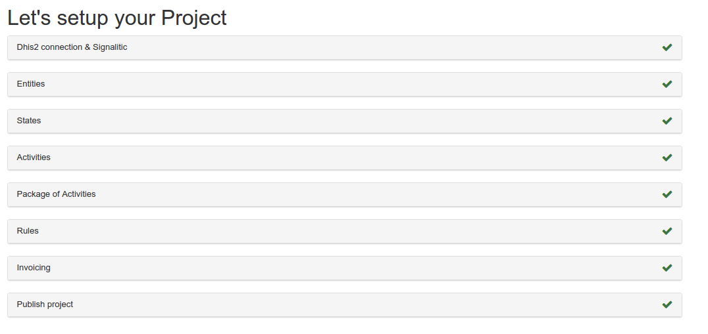
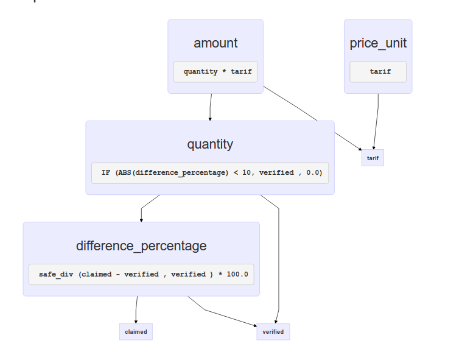
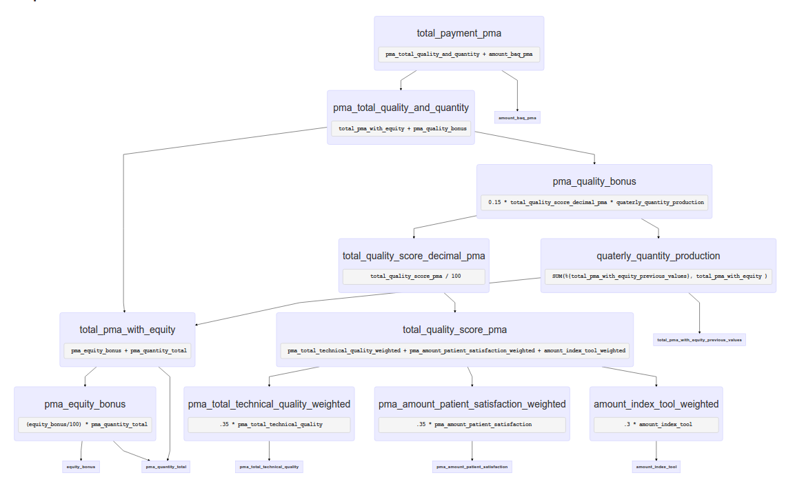
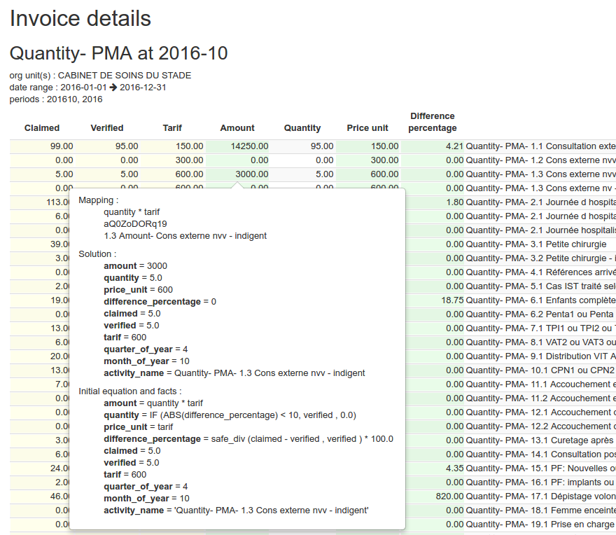

# About


A rule engine on top of [dhis2](https://www.dhis2.org/) developed by [Bluesquare](https://bluesquarehub.com/), to let power users describe their Results-Based Financing  scheme.

More info about the tool https://bluesquarehub.com/services/openrbf-2-0/

Created with the support of the [World Bank](http://www.worldbank.org/).


Thanks to the [DHIS2](http://dhis2.org) team for their help and support


# Using

A wizard approach guiding you in the setup of projects



With your rules editor and visual explanation





each formula will be mapped to a dhis2 data element.

You can easily verify your formula with the invoicing simulation form
with a built-in invoice explainer showing you how was this amount/score calculated



Every change is tracked and you publish your project draft to be used at a given period.

### Database

The database configuration is handled in database.yml.

Rails limits the number of database connections with he `pool` setting. This is the maximum size of the connections your app can have to the database.

A puma worker on 1 dyno will need `RAILS_MAX_THREADS` connections.
Sidekiq on 1 dyno will need `SIDEKIQ_CONCURRENCY` connections.

Rails maintains its own database connection pool, with a new pool created for each worker process/dyno.
Threads within a worker/dyno will operate on the same pool.

The current pool is set to `ENV["DB_POOL"] || ENV['SIDEKIQ_CONCURRENCY'] || ENV['MAX_THREADS'] || 5`.

#### Current size

In production, we currently have:

  `SIDEKIQ_CONCURRENCY` => 20
  `MAX_THREADS`         => 5
  `WEB_CONCURRENCY`     => 1
  `DB_POOL`             => 1

This means that we need a `DB_POOL` of:

```
      [SIDEKIQ_CONCURRENCY, MAX_THREADS*WEB_CONCURRENCY].max
      => [20, 5*1].max
      => 20
```

The current pool size is `20`.

(Run `bundle exec rake config:check_db_pool` to get a live version of this output)

# Contributing

## Dependencies and config

Run `script/setup`, this should install all dependencies and create the local databases.

Run `script/test` to check if everything was successfull.

A default user and program will be create by the `db/seeds.rb` file.

## Seed a project

We have an example project that can be created using the public DHIS2 demo instance (https://play.dhis2.org/demo/) to showcase a RBF project configuration:

http://127.0.0.1:3000/setup/seeds

This will generate a "typical" RBF project with quality, quantity & payment rules for you to explore and play with.

## Admin interface

You can access any element in the application using the admin interface at

http://127.0.0.1:3000/admin

## Optional

If you set an ENV variable for `LOG_ROCKET_TOKEN`, a [logrocket](https://logrocket.com) session will be started. (Currently only enabled in production)

# Tests

Run the tests after any change:

    bin/rspec

# Deploying

orbf2 runs as a docker image on AWS Elastic Beanstalk (infra in [terraform-orbf2-eb](https://github.com/BLSQ/terraform-orbf2-eb)), with 2 environments per stage: web and sidekiq.

| stage   | web                   | sidekiq                 | url                                   |
| ------- | --------------------- | ----------------------- | ------------------------------------- |
| prod    | `orbf2-prod-20230114` | `orbf2-prod-sidekiq`    | https://orbf2.bluesquare.org          |
| staging | `orbf2-staging`       | `orbf2-staging-sidekiq` | https://orbf2-staging.bluesquare.org  |

1. build and push the image: run the [publish](./.github/workflows/publish.yml) workflow on the branch to deploy, with the version tag `git describe --tags --always` gives on its head commit, dashes replaced by dots (e.g. `1.0-399-g678fbb5c` → `1.0.399.g678fbb5c`)

   ```
   gh workflow run publish.yml --ref master -f version=1.0.399.g678fbb5c
   ```

   it builds [Dockerfile.build](./Dockerfile.build) and pushes `blsq/hesabu:<version>` to Docker Hub

2. point the [Dockerfile](./Dockerfile) to that image (`FROM blsq/hesabu:<version>`), commit ("prepare deploy") and push

3. deploy with the [eb cli](https://docs.aws.amazon.com/elasticbeanstalk/latest/dg/eb-cli3.html) (needs AWS credentials and the `.elasticbeanstalk/config.yml` of `eb init`, application `orbf2`, region `eu-central-1`); it deploys the committed HEAD of the checkout, then prints the `/status` of both environments

   ```
   ./script/deploy_prod      # or ./script/deploy_staging
   ```

   to not kill running jobs, the sidekiq worker is drained first ([script/sidekiq_drain](./script/sidekiq_drain), through `eb ssh`, needs the environment key in `~/.ssh`): it's quieted (stops fetching jobs, new ones wait in redis), web is deployed while the running jobs finish, then sidekiq is deployed once no job runs. After `DRAIN_TIMEOUT` (default 900s) it asks to wait more, deploy anyway or abort (an aborted worker stays quiet until `eb restart <env>`).

   ```
   ./script/sidekiq_drain busy orbf2-prod-sidekiq   # see the running jobs
   ```

## Hesabu manager

The [hesabu-manager](https://github.com/BLSQ/hesabu-manager/) react app is bundled in the image and served at `/setup/manager`. The image build (`rake hesabu_manager:install`) downloads the latest build from https://hesabu-manager-build.s3.amazonaws.com/Hesabu.zip, published by each push on the hesabu-manager `develop` branch. To ship a hesabu-manager change: merge it on `develop`, wait for its "Build and publish to s3 bucket" workflow, then build and deploy orbf2 as above.

A specific build can be installed with the `HESABU_MANAGER_BUILD` build arg (zip url, zip file or build dir), see [hesabu_manager.rake](./lib/tasks/hesabu_manager.rake).

It can also be deployed as a dhis2 app in the dhis2 of the projects, from a running container (e.g. `eb ssh`):

```
bundle exec rake ui:setup_all
bundle exec rake ui:deploy_all
```

# Sub modules & related projects

* https://github.com/BLSQ/orbf-rules_engine/ (equations building blocks extracted from this repo)
* https://github.com/BLSQ/hesabu         (ruby facade of go-hesabu for equation solving)
* https://github.com/BLSQ/go-hesabu      (golang implementation to speed up invoice calculations)
* https://github.com/BLSQ/hesabu-manager dhis2 app to replace the rails frontend here
* https://github.com/BLSQ/blsq-report-components  react components to allow building invoice apps (dhis2 dedicated apps with invoice templates, custom data entries, contracts modules,... )
